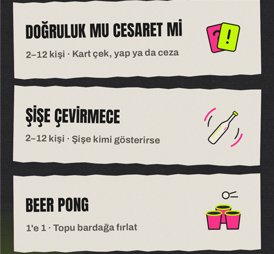
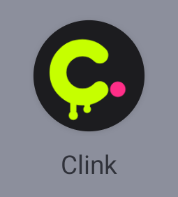

# Clink — Çizim brifi

Bu brif, Clink'in oyun çizimlerini ve uygulama simgesini yaptırmak için hazırlandı. Bir tasarımcıya ya da bir yapay zekâ görsel aracına olduğu gibi verilebilir. Şu an uygulamada bu görsellerin yerinde vektör olarak çizilmiş geçici çizimler duruyor (ekran görüntüleri aşağıda). Gelen görseller bunların yerine konacak.

## Uygulama hakkında kısaca

Clink, arkadaş ortamında tek telefonla oynanan bir parti oyunları uygulaması: Doğruluk mu Cesaret mi, Şişe Çevirmece, Cup Pong ve Kim Daha Çok?. Görsel dili **"sokak / graffiti"**: koyu bir tuğla duvar, üstüne yapıştırılmış yırtık kenarlı kağıt afişler, neon sprey renkleri, maskeleme bandı etiketleri. Dağınık değil, temiz ve "tasarlanmış" bir graffiti.

## İstenen görseller (5 adet)

| # | Görsel | Ne anlatmalı | Uygulamada nerede |
|---|---|---|---|
| 1 | **Doğruluk mu Cesaret mi** | Yelpaze gibi açılmış iki oyun kartı; biri soru (merak), biri cesaret (heyecan) hissi versin. Kartların üstünde yazı olmasın; "?" ve "!" gibi işaretler kullanılabilir. | Oyun listesinde, oyunun afişinin sağında (yaklaşık 76×76 dp) |
| 2 | **Şişe Çevirmece** | Dönen, **etiketsiz düz bir cam şişe**, hareket çizgileriyle. Hiçbir içki markası ya da içki çağrışımı olmasın (etiket yok, içinde sıvı yok). | Oyun listesi |
| 3 | **Cup Pong** | Üçgen dizilmiş **boş** bardaklar ve havada bir top. Bardaklarda sıvı ya da köpük olmasın. | Oyun listesi |
| 4 | **Kim Daha Çok?** | Üç el ya da ok, ortadaki tek bir kişiyi gösteriyor. Kişinin yüzü belirgin olmasın; herkes olabilecek biri. | Oyun listesi |
| 5 | **Uygulama simgesi** | Sprey boyayla yazılmış küçük harf bir **"c"**, yanında pembe bir **nokta**, harften aşağı akan iki boya damlası (logodaki "clink." yazısının kısaltması). | Telefonun ana ekranı ve uygulama çekmecesi |

## Stil

- **Graffiti çıkartma (sticker) tarzı:** kalın, mürekkep siyahı dış çizgi (bütün görsellerde aynı kalınlıkta), düz renk dolgu, çok hafif bir grenli doku. Gölge varsa sert ve bulanık olmayan bir gölge.
- **Dört görsel aynı elden çıkmış gibi görünmeli:** aynı çizgi kalınlığı, aynı renkler, aynı ışık.
- **Görselin içinde yazı olmayacak** (harf, kelime, logo yok). Tek istisna simgedeki "c" harfi.
- **İçki çağrışımı olmayacak:** şişede etiket yok, bardaklar boş, köpük ya da sıvı yok.
- Fotogerçekçi değil; 3B render değil; çocuksu karikatür de değil.

## Renk paleti

Sadece bu renkler kullanılsın (açık/koyu tonları serbest değil):

| Ad | Hex | Kullanım |
|---|---|---|
| Duvar | `#1C1C1F` | Simgenin arka planı |
| Kabarık duvar | `#26262A` | Koyu yüzeyler (ör. boş bardağın içi) |
| Kağıt | `#F4EFE3` | Açık yüzeyler (ör. top, şişe camı) |
| Mürekkep | `#141414` | Dış çizgiler |
| Asit yeşili | `#C6FF00` | Ana vurgu |
| Pembe | `#FF2E88` | İkinci vurgu |
| Kehribar | `#FFB020` | Üçüncü vurgu (az kullanılsın) |
| Bant | `#E8DCB5` | İsteğe bağlı |

Not: Oyun çizimleri krem renkli bir kağıt afişin (`#F4EFE3`) üstünde duracak; bu zeminde iyi okunmalı.

## Teslim

- **Oyun çizimleri (1–3):** her biri **1024×1024 px, şeffaf arka planlı PNG**. Çizim karenin içinde ortalı olsun, kenarlarda yaklaşık %8 boşluk kalsın.
- **Uygulama simgesi (4):** **1024×1024 px şeffaf PNG**, sadece "c" + nokta + damlalar (arka plan rengini uygulama kendisi veriyor). Bütün çizim, karenin ortasındaki **%61'lik daire** içinde kalmalı (Android simgeyi daire, kare ya da damla şeklinde kırpabiliyor). Ek olarak aynı şeklin **tek renkli (siyah, şeffaf zeminli)** bir sürümü: Android 13+ telefonlarda temalı simge için.
- Varsa **kaynak dosya** (AI, SVG, PSD, Figma vb.).
- Boyutlandırma ve uygulamaya yerleştirme bizde.

## Lisans

- Görseller, **uygulama mağazasında yayımlanan ticari bir uygulamada** kullanılabilmeli. Tasarımcıyla çalışılıyorsa kullanım hakkının devredildiği yazılı olarak teyit edilmeli.
- Bir yapay zekâ aracı kullanılırsa, aracın kullanım şartlarının ticari kullanıma izin verdiği (ve üretilen görselin hakkının kullanıcıda olduğu) kontrol edilmeli. Bu kontrolü Mehmet yapar.
- Başka bir eserden, karakterden ya da markadan kopya ya da taklit olmamalı.

## Şu anki geçici çizimler

Oyun listesi (geçici çizimler afişlerin sağında):

Uygulama simgesi (uygulama çekmecesinde, daire şeklinde kırpılmış hâli):

